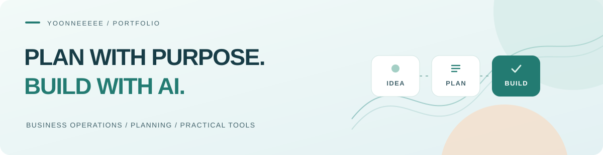

# 아이디어를 설계하고, AI와 함께 실행합니다.

**AI를 활용하는 사업 운영자 · 기획자**

사업과 서비스에 필요한 일을 정리하고, 
AI를 활용해 실제로 쓸 수 있는 도구와 웹서비스로 연결합니다.

[대표 작업](#대표-작업) · [학습 기록](#학습-기록)

---

### 관심을 두는 일

- **사업 · 서비스 기획** — 필요한 문제와 사용자의 흐름을 구체적으로 정리하기
- **AI를 활용한 실행** — 아이디어를 시제품과 작은 도구로 만들어 확인하기
- **업무 개선** — 반복되는 일과 일상 속 불편을 줄일 방법 찾기

### 대표 작업

#### 01. ThinkWave | 인재풀 관리 · 업무 효율화

> 사내 업무용 · 비공개 프로젝트

개발자·프리랜서 정보를 관리하고 프로젝트 제안·지원 이력을 한곳에서 확인하기 위해 직접 만든 인재풀 관리 페이지입니다.

- **기획 목적** — 반복적인 인재 정보 등록·조회·정리 업무를 줄이고, 인력 운영 흐름을 한곳에 모으기
- **주요 기능** — 인재 정보 등록·조회·수정, 이력서 업로드, 프로젝트 제안·지원 이력 관리
- **운영 개선** — 중복 등록·정보 충돌 방지 규칙과 운영 점검 항목 반영
- **진행 방식** — 실제 업무 요구를 화면과 기능으로 정리하고, AI를 활용해 구현·개선

`업무 프로세스 기획` `AI 활용` `인재 정보 관리` `내부 도구`

#### 02. ThinkWave | 씽크웨이브 회사 홈페이지

회사와 사업을 소개하고, 고객 문의와 개발자 지원으로 이어지는 기업 홈페이지입니다.

- 회사 소개, 사업 영역, 기술 · 솔루션, 주요 실적을 페이지별로 구성했습니다.
- 고객 문의는 외부 양식, 개발자 지원은 이메일로 연결합니다.
- 모바일 메뉴와 메일 작성 대체 안내를 제공합니다.

`서비스 구성` `사용자 흐름` `정적 웹사이트`

[홈페이지 보기 ↗](https://thinkwave.co.kr/)

#### 03. 모닝스위머 | 손글씨 · 도장 누끼따기

사진 속 손글씨나 도장을 문서에 넣기 쉽도록 배경을 투명하게 만드는 웹 도구입니다.

- 진하기 기준, 글씨 색, 회전, 저장 범위를 조절하며 결과를 미리 확인할 수 있습니다.
- 투명 PNG 저장과 이미지 복사를 지원합니다.
- 이미지는 서버에 업로드하지 않고 **브라우저 안에서 처리**합니다.

`HTML` `CSS` `JavaScript` `Canvas`

[도구 사용하기 ↗](https://yoonneeeee.github.io/morningswimmer/nukki/) · [코드 보기](https://github.com/yoonneeeee/morningswimmer/tree/main/nukki)

### 학습 기록

**Java · JDBC · Oracle SQL**

기초 문법, 객체지향, 데이터베이스 연동과 SQL을 실습한 코드를 모았습니다.

[KH 교육과정 실습 기록 보기](https://github.com/yoonneeeee/KH)

